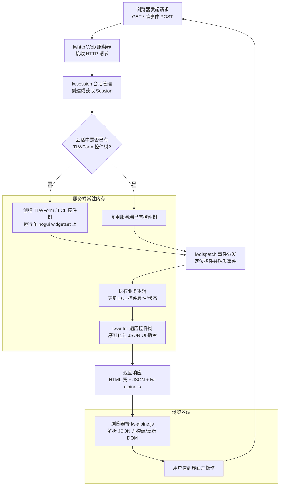
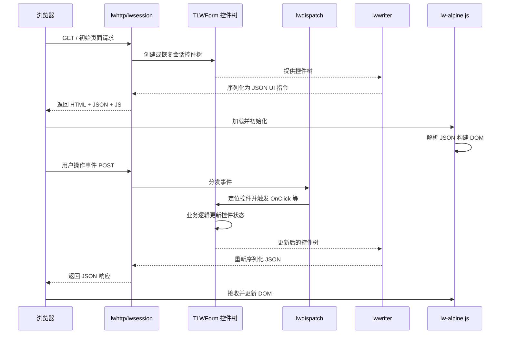
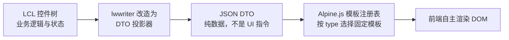

# lazarusWeb 工作流程与 DTO 改造示意

> 说明：以下按 **lazarusWeb 默认工作流程** 画图。这是基于其“服务端 LCL 控件树 + JSON 序列化 + Alpine.js 前端渲染”的架构概括，不是逐行源码级时序。

## 1. 总体架构流程图

核心点：**服务端控件树在会话期间常驻内存**，每次交互后由 `lwwriter` 重新序列化，浏览器端 `lw-alpine.js` 负责解释 JSON 并渲染。

## 2. 一次交互的时序图

## 3. 你设想的 DTO 改造后差异点

如果按之前设想的“JSON 输出纯数据 DTO，前端继续用 Alpine.js”，流程图只改中间两段：

也就是说：**服务端控件树保留，但 JSON 从“UI 指令快照”变成“数据 DTO”，前端从“UI 树解释器”变成“DTO 消费者”**。内存压力不会消失，因为控件树仍常驻服务端；改变的是序列化内容和前端渲染职责。

> 以上 Mermaid 图可直接复制到 Mermaid Live Editor 或支持 Mermaid 的 Markdown 工具中渲染。